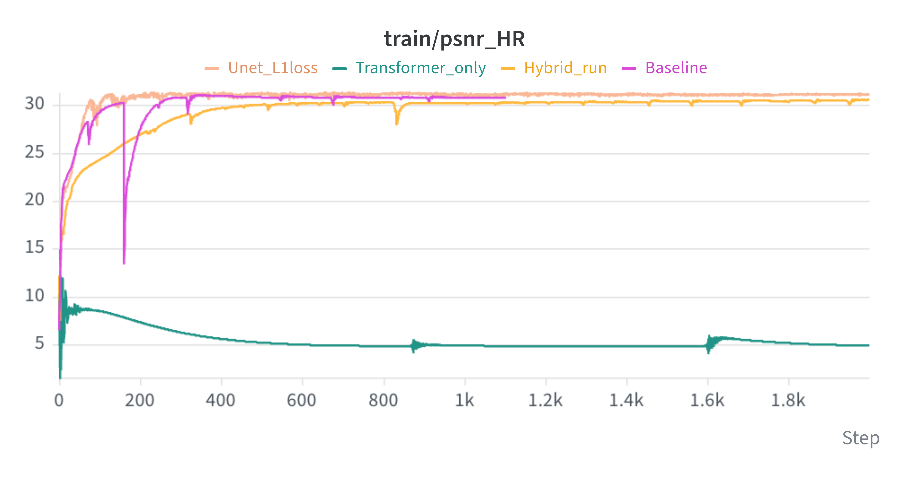

# Deep Image Prior (DIP) Super-Resolution Experiments

Weights and Biases Runs : https://forge.coreweave.com/wandb/shriramgolla-iit-hyderabad/Medical%20Imaging?nw=nwusershriramgolla

Weights and Biases Report Link : https://forge.coreweave.com/wandb/shriramgolla-iit-hyderabad/Medical%20Imaging/reports/DIP-Experiment-runs--VmlldzoxODEzNzU5NQ?accessToken=ococ0nqiafcm82yitykxs6hesfk1yf4dpnjxry77yzcauy9b0gp988cij1ewwheq
## Objective

Study how DIP reconstruction quality changes under different network architectures, loss functions, noise-input strategies, and input-noise perturbation radii for the same super-resolution task.

Use the same high-resolution reference image, low-resolution observation, downsampling operator, and evaluation protocol for fair comparisons. Record PSNR, SSIM, data-consistency loss, runtime, and reconstruction images.

## Experiment 1 — Baseline DIP U-Net

**Goal:** Establish reference performance for the original DIP U-Net.

- **Architecture:** Original DIP U-Net / skip network.
- **Input:** One fixed noise tensor, `z`.
- **Loss:** Original baseline objective, typically low-resolution data-consistency MSE
- **Training:** Optimize the U-Net parameters using the baseline objective.

## Experiment 2 — Hybrid CNN–Transformer at the Bottleneck

**Goal:** Test whether global context at the bottleneck improves reconstruction while retaining the U-Net's convolutional encoder and decoder.

- **Architecture:** Keep the U-Net encoder and decoder; replace or augment the bottleneck with a Transformer block.
- **Input:** One fixed noise tensor, `z`.
- **Loss:** Same loss as Experiment 1.
- **Training:** Keep the data, downsampler, optimization budget, and evaluation settings consistent with the baseline.

## Experiment 3 — Full Transformer-Based DIP

**Goal:** Compare a Transformer-dominant generator against the CNN-based DIP generator.

- **Architecture:** A Transformer-based generator that maps the same kind of fixed noise input to an image. This replaces the U-Net architecture for this experiment only.
- **Input:** One fixed noise tensor, `z`, adapted to the Transformer generator.
- **Loss:** Same data-consistency objective as Experiment 1, adapted to the output shape.
- **Training:** Use the same observation and evaluation protocol. Document architecture-specific changes.

**Research question:** How does a full Transformer generator compare with the U-Net and hybrid architecture?

## Experiment 4 — DIP U-Net with L1 Data-Consistency Loss

**Goal:** Determine how replacing the baseline MSE data term with L1 changes reconstruction quality.

- **Architecture:** Original DIP U-Net.
- **Input:** One fixed noise tensor, `z`.
- **Loss:** L1 error between the downsampled reconstruction and observed low-resolution image:

  $$
  \mathcal{L}_{\mathrm{data}} = \left\|D(G_\theta(z))-y_{\mathrm{LR}}\right\|_1
  $$

- **Training:** Change the data-consistency loss from MSE to L1. Keep other settings unchanged where possible.

## Experiment 5 — Two Noise Inputs and Interpolation

**Goal:** Study how one trained DIP network's output changes when its noise input moves between two independent noise vectors.

- **Architecture:** Original DIP U-Net with shared network weights.
- **Inputs:** Two same-shaped noise tensors, `z1` and `z2`, initialized independently.
- **Training:** Train the shared U-Net using both inputs against the same low-resolution observation. A possible objective is:

  $
  \mathcal{L}_{\mathrm{data}} = \frac{1}{2}\left[\left\|D(G_\theta(z_1))-y_{\mathrm{LR}}\right\|_2^2 + \left\|D(G_\theta(z_2))-y_{\mathrm{LR}}\right\|_2^2\right]
  $

  If output consistency is part of the intended experiment, add:

  $
  \mathcal{L}_{\mathrm{consistency}} = \lambda_c\left\|G_\theta(z_1)-G_\theta(z_2)\right\|_1
  $

  Report `lambda_c`. If consistency is not being tested, set it to zero.

- **Interpolation after training:** Freeze the trained U-Net weights and linearly interpolate the inputs:

  $$
  z_\alpha=(1-\alpha)z_1+\alpha z_2,\qquad \alpha\in[0,1]
  $$

  Evaluate the same network at values such as 0.0, 0.1, ..., 1.0. Visualize the outputs and measure PSNR and SSIM against the HR reference when ground truth is available.

## Radius Ablation for Experiments 1–4

**Scope:** The radius ablation is a secondary evaluation applied separately to each of the first four experiments—not a standalone sixth model or training experiment. Run it for:

1. **Experiment 1:** Baseline DIP U-Net.
2. **Experiment 2:** Hybrid CNN–Transformer at the bottleneck.
3. **Experiment 3:** Full Transformer-based DIP.
4. **Experiment 4:** DIP U-Net with L1 data-consistency loss.

Train each model variant using its own experiment's specified objective. Then freeze that trained model and evaluate how its output changes under the same set of input-noise radii. Do not retrain the model for each radius.

### Perturbation protocol

Use the radius values:

`radii = [0, 0.01, 0.1, 0.5, 1, 5, 10]`

Let `z` be the original input tensor used by the relevant model, and let `epsilon_r` be the additional random noise sampled for radius `r`. The supplied code generates a fresh perturbation for each radius, so the input is:

$$
z_r = z + r\epsilon_r
$$

For every model in Experiments 1–4, preserve the base input once before the loop (for example, `base_input = net_input.detach().clone()`). For each radius, generate `radius_noise` with the same shape as `base_input`, construct `base_input + radius * radius_noise`, and pass it to the frozen model. Do not overwrite the base input inside the loop.

